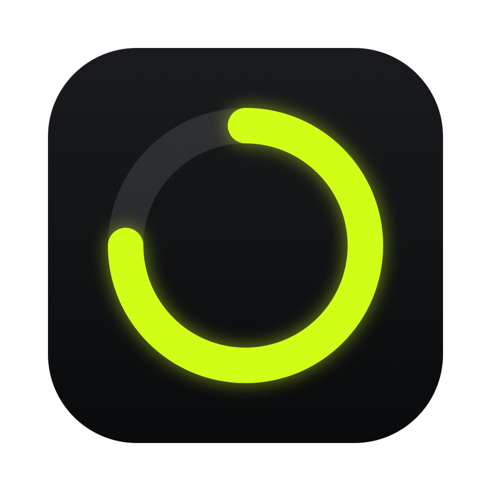
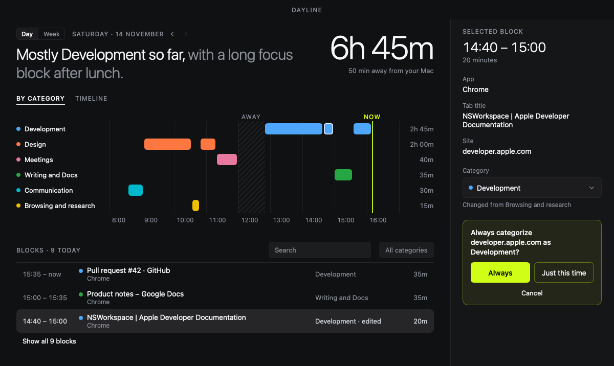
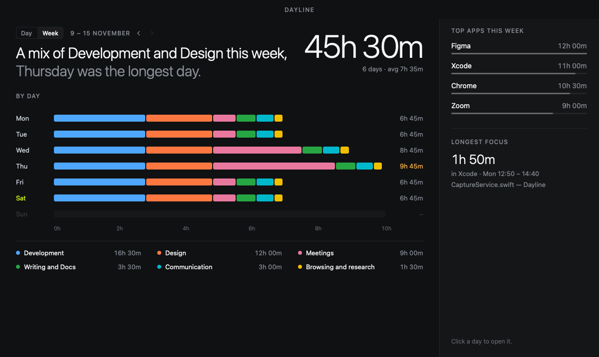
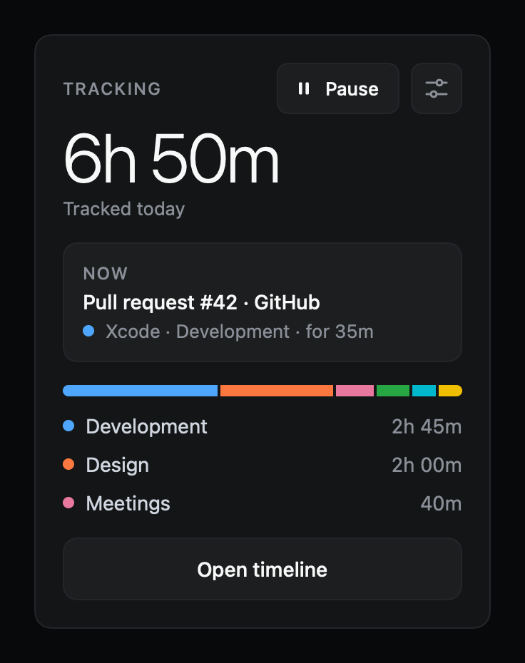
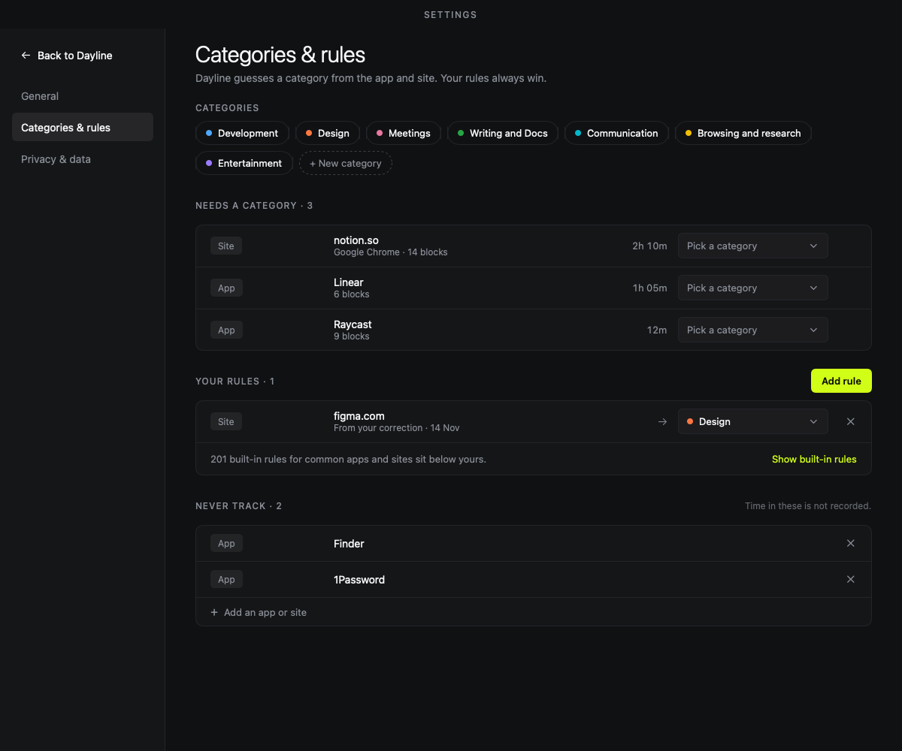

# Dayline

An automatic time tracker for macOS. Dayline sits in the menu bar and records which app you are in and, for Google Chrome, which tab and site. There are no timers to start and nothing to type. Time you are away (idle, asleep, locked) is shown as a gap, not guessed.

Everything stays on your Mac in one SQLite file. Dayline has no account and makes no network requests.





| The week | The menu bar popover |
|---|---|
|  |  |



The screenshots use sample data and are rendered with `swift run ui-snapshots`.

## What it sees, and what it never sees

| Sees | Never sees |
|---|---|
| Which app you are in | Screenshots or screen contents |
| Window and Chrome tab titles, and the site (host and domain, never the path) | Keystrokes or clipboard |
| When you are active or away, and whether a mic or camera is in use | Page contents |

Chrome Incognito windows are skipped by default, and any app or site can be excluded in Settings.

## Requirements

- macOS 14 or later
- Xcode 16 or later (for the Swift toolchain), to build
- One permission: Accessibility (System Settings → Privacy & Security → Accessibility)

## Build and install

```bash
git clone https://github.com/lovromaricic/dayline.git && cd dayline
./scripts/install.sh
```

`install.sh` builds the app, signs it and puts it in `/Applications`. It signs with the first "Apple Development" certificate in your keychain; Xcode creates one for free when you add your Apple ID under Xcode → Settings → Accounts. To use another identity:

```bash
SIGN_IDENTITY="Apple Development: you@example.com (TEAMID)" ./scripts/install.sh
```

A stable signature matters: macOS ties the Accessibility grant to it, so rebuilds keep the permission. If your certificate is renewed, macOS asks once more.

### Downloaded builds

Dayline is not notarized. If you download a build instead of building it, macOS blocks the first launch. Open System Settings → Privacy & Security and click **Open Anyway** under the message about Dayline.

## Using it

- **Menu bar:** the ring fills toward 8 hours of tracked time. Click for today's summary, ⌥-click to pause or resume, right-click for pause lengths, Open timeline and Quit.
- **Timeline** (Open timeline in the popover, or right-click the menu bar item): a one-line summary of the day, lanes per category, the blocks list and an inspector. Select a block to change its category; Dayline offers to remember it as a rule. Drag a bar to another lane for the same thing. ←/→ moves between days, ↑/↓ through blocks, ⌘F searches. Every number adds up: blocks to their category, categories to the day's total.
- **Week:** the Day/Week switch shows each day of the week split by category, with the week's total and average.
- **Calls:** while a mic or camera is in use you stay tracked even without typing, and apps with no category of their own count as Meetings.
- **Settings** (⌘,): start at login, the away threshold, calls, Chrome titles, an optional end-of-day recap notification, categories and rules (with a list of apps and sites that still need a category), never-track list, history length, export (CSV, JSON) and delete all.

## Data

- Database: `~/Library/Application Support/Dayline/dayline.sqlite`
- Log (apps and sites only, no titles): `~/Library/Logs/Dayline/dayline.log`
- A day's raw segments in the terminal: `swift run dayline-report [YYYY-MM-DD]`

## Development

```bash
swift test                       # unit tests
./scripts/build-app.sh           # build/Dayline.app
./scripts/run-app.sh             # run the build/ copy instead of /Applications
swift run ui-snapshots           # render screens to build/snapshots for design review
swift scripts/make-icon.swift    # regenerate Resources/AppIcon.icns
./scripts/update-psl.sh          # refresh the compiled-in Public Suffix List
```

Always launch the app bundle (the scripts use `open`). Running the bare executable, including from Xcode's Run button, makes macOS check the terminal's or Xcode's Accessibility permission instead of Dayline's.

| Module | Role |
|---|---|
| `Domain` | Models, segmenter, blocks and day summaries. No AppKit, fully unit-tested. |
| `Capture` | Frontmost app, Accessibility titles, Chrome URL and Incognito, idle, sleep/lock, mic/camera. |
| `Categorize` | Rule resolution and the built-in rules. |
| `Store` | SQLite through GRDB. |
| `UI` | SwiftUI views for the popover, timeline and Settings. |
| `Dayline` | The app: wires it all together. |

The product spec and design files are in `design/`; acceptance-test status is in `design/ACCEPTANCE.md`.

## License

MIT. See [LICENSE](LICENSE). The compiled-in Public Suffix List is under the Mozilla Public License 2.0.
